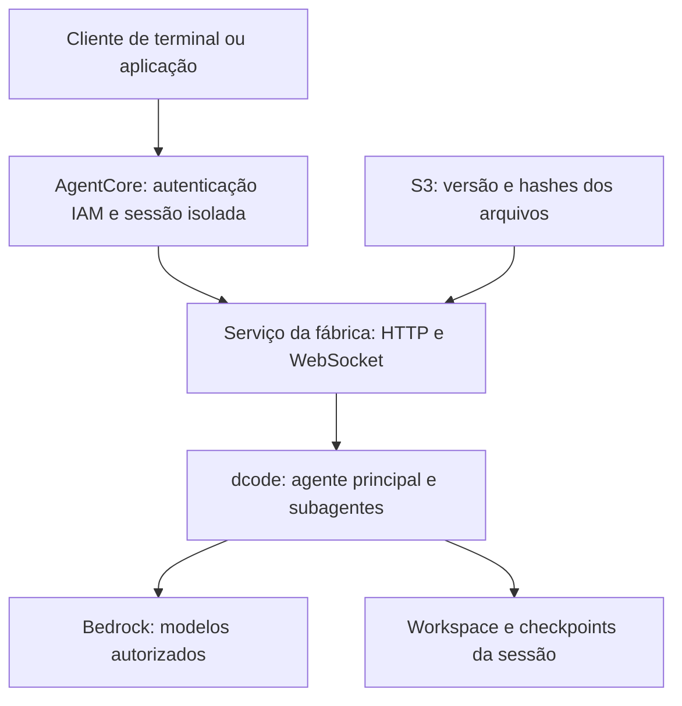

# Agent Factory on AWS AgentCore

Fábrica de equipes de agentes com **LangChain Deep Agents Code (`dcode`)**, executada
no **Amazon Bedrock AgentCore Runtime**, com definições versionadas no **Amazon S3**
e infraestrutura em **Terraform**.

Uma imagem genérica atende várias equipes. Para criar uma equipe, publique um novo
prefixo no S3 com o agente principal, subagentes, skills e configuração MCP. Cada
sessão fica vinculada a uma versão e tem seu próprio workspace e perfil do dcode.

**Status: MVP com verificação local de dcode real (inicialização e retomada ACP),
transporte WebSocket e Terraform.** A CI também constrói e testa a imagem ARM64.
Provisionamento AWS, persistência no AgentCore e chamadas reais a modelos ainda
precisam de validação no ambiente de destino. Veja [as evidências e limites](docs/validation.md).

## Arquitetura



- **Python 3.12, ASGI e Uvicorn:** serviço pequeno, sem outro framework web.
- **dcode 0.1.87:** executado como subprocesso sem fork do upstream.
- **ACP sobre WebSocket:** streaming, delegação e aprovações preservadas.
- **S3:** fonte das definições, com manifesto publicado por último e SHA-256 por arquivo.
- **Terraform AWS provider 6.69.x:** recurso nativo `aws_bedrockagentcore_agent_runtime`.
- **AgentCore managed session storage:** workspace, perfil e checkpoints em `/mnt/workspace`.

O backend `dcode --sandbox agentcore` é outra integração, voltada ao Code Interpreter.
Este projeto hospeda o processo dcode completo no **AgentCore Runtime**, usando as
ferramentas locais dentro da sessão isolada. Ele não cria um Code Interpreter adicional.

## Pré-requisitos

- Python 3.12+, Terraform 1.10+, Docker com Buildx e AWS CLI v2.
- Conta AWS e região com AgentCore Runtime, WebSocket e session storage habilitados.
- Acesso ao modelo Bedrock escolhido. O exemplo usa um US inference profile de Claude
  Sonnet 4.5; ajuste modelo, região e ARNs permitidos se necessário.
- Identidade de provisionamento com permissões para S3, ECR, IAM, AgentCore e `iam:PassRole`.
- Identidade do cliente com a política retornada em `caller_policy_json`.

Não coloque chaves AWS no repositório, no manifesto ou em arquivos de skills.
Use AWS SSO/perfis localmente e a execution role no runtime.

## Provisionar e executar

### 1. Instalar e testar

```bash
python -m venv .venv
source .venv/bin/activate
pip install -e '.[agent,client]'
PYTHONPATH=src python -m unittest discover -s tests -v
```

### 2. Criar a base com Terraform

```bash
cp infra/terraform.tfvars.example infra/terraform.tfvars
terraform -chdir=infra init
terraform -chdir=infra plan -out=bootstrap.tfplan
terraform -chdir=infra apply bootstrap.tfplan
```

Sem `runtime_image_uri`, o primeiro apply cria S3, ECR e IAM. Isso resolve a dependência
entre a imagem e o Runtime sem `-target`, `local-exec` ou scripts de provisionamento.
O Terraform não publica equipes: a publicação é uma operação separada, versionada.

O estado Terraform é local por padrão e está no `.gitignore`. Antes de colaboração
ou automação de deploy, configure um backend remoto com criptografia e locking;
`infra/backend.tf.example` mostra a configuração. O bucket de estado deve existir
separadamente. Não use o bucket de definições como backend de estado.

### 3. Construir e publicar a imagem ARM64

Execute no Bash, a partir da raiz do projeto. Ajuste a região se mudou o tfvars.

```bash
FACTORY_AWS_REGION=us-west-2
FACTORY_ECR_URL=$(terraform -chdir=infra output -raw ecr_repository_url)
FACTORY_IMAGE_TAG=$(git rev-parse --short=12 HEAD)
aws ecr get-login-password --region "$FACTORY_AWS_REGION" | docker login \
  --username AWS --password-stdin "${FACTORY_ECR_URL%%/*}"
docker buildx build --platform linux/arm64 --provenance=false \
  --tag "$FACTORY_ECR_URL:$FACTORY_IMAGE_TAG" --push .
FACTORY_IMAGE_DIGEST=$(aws ecr describe-images --region "$FACTORY_AWS_REGION" \
  --repository-name "${FACTORY_ECR_URL#*/}" \
  --image-ids "imageTag=$FACTORY_IMAGE_TAG" --query 'imageDetails[0].imageDigest' --output text)
```

ECR usa tags imutáveis: use uma nova tag a cada build. O runtime recebe um digest,
não `latest`. As dependências transitivas do dcode ainda usam os intervalos do upstream;
a imagem por digest é a unidade de reprodução do deployment.

### 4. Publicar uma equipe no S3

```bash
agent-factory publish examples/software --team software --version v001 \
  --model 'bedrock:us.anthropic.claude-sonnet-4-5-20250929-v1:0' \
  --bucket "$(terraform -chdir=infra output -raw definitions_bucket)"
```

Se alterar `definitions_prefix` no Terraform, passe o mesmo valor em `--prefix`.
O publicador usa `If-None-Match: *`: repetir conteúdo igual funciona; tentar substituir
um arquivo existente por conteúdo diferente falha. O manifesto é escrito por último,
então uma publicação interrompida não expõe uma release parcialmente pronta.

Essa imutabilidade é uma regra do publicador, não S3 Object Lock. Os hashes verificam
integridade, não autenticidade. Quem tem permissão de escrita no bucket controla as
definições; restrinja essa permissão ao processo de publicação.

### 5. Criar o runtime usando a imagem publicada

```bash
terraform -chdir=infra plan \
  -var="runtime_image_uri=$FACTORY_ECR_URL@$FACTORY_IMAGE_DIGEST" -out=runtime.tfplan
terraform -chdir=infra apply runtime.tfplan
```

**Depois, registre `runtime_image_uri` em `infra/terraform.tfvars`** ou no mecanismo de
variáveis do seu ambiente. O valor fornecido por `-var` não é salvo no tfvars; omiti-lo
num próximo plan faria o Terraform propor a remoção do runtime.

### 6. Conversar com a equipe

```bash
agent-factory chat --team software --version v001 \
  --region "$FACTORY_AWS_REGION" \
  --runtime-arn "$(terraform -chdir=infra output -raw runtime_arn)"
```

O cliente usa o SDK oficial AgentCore para assinar a conexão WebSocket com SigV4.
Ele mostra dois identificadores: **runtime session ID** e **ACP session ID**. Guarde
ambos para retomar a conversa após desconexão:

```bash
agent-factory chat --team software --version v001 --region us-west-2 \
  --runtime-arn 'ARN_DO_RUNTIME' \
  --runtime-session-id 'ID_DA_SESSAO_RUNTIME' --resume 'ID_DA_SESSAO_ACP'
```

A conexão anterior precisa estar encerrada e seu processo ter terminado. Aprovações
de ferramentas aparecem no terminal; Enter nega. `/exit` encerra o cliente. Interromper
o cliente encerra o processo dcode e seus filhos; tarefas não continuam em background
após a desconexão. O próximo cliente pode carregar o checkpoint persistido.

## Definir uma nova equipe

Copie `examples/software` e personalize:

| Caminho relativo | Finalidade |
|---|---|
| `profile/config.toml` | Configurações do dcode |
| `profile/.mcp.json` | Servidores MCP administrados pela equipe |
| `profile/<team>/AGENTS.md` | Instruções adicionais do agente principal |
| `profile/<team>/agents/<name>/AGENTS.md` | Nome, descrição, prompt e modelo opcional do subagente |
| `profile/<team>/skills/<name>/SKILL.md` | Skill no padrão Agent Skills |
| Arquivos adicionais dentro da skill | Referências e scripts invocados pela skill |

O publicador gera o `manifest.json` com versão do schema, versão exata do dcode,
equipe, versão da release, modelo principal e hashes. Não é necessário editar hashes.
No S3 os objetos ficam em `teams/<team>/releases/<version>/`.

Uma release nova exige uma **nova sessão Runtime** para entrar em vigor. Sessões
existentes permanecem presas à release original, inclusive quando há tentativa de
alterar seu manifesto. Mudanças feitas pelo dcode no perfil de uma sessão não são
publicadas de volta no S3 automaticamente.

Subagentes definidos por `AGENTS.md` suportam nome, descrição, instruções e modelo
opcional. Eles herdam as ferramentas do agente principal. O dcode não oferece nesse
formato `tools`, `skills`, `middleware` ou `interrupt_on` exclusivos por subagente.
Para esse controle, a evolução recomendada é um backend pelo SDK Deep Agents.
Subagentes compartilham processo de execução, workspace e credenciais da sessão;
separação de contexto não significa isolamento de segurança.

Novas instruções, skills e configurações podem vir pelo S3 sem rebuild. Novas
dependências Python, ferramentas de sistema ou mudanças no serviço exigem nova imagem.
O exemplo inclui Git e Python; adicione Node.js ou outras ferramentas ao Dockerfile
se sua equipe precisar executar projetos nessas stacks.

## Desenvolvimento local

```bash
agent-factory pack examples/software --team software --version v001 \
  --model 'bedrock:us.anthropic.claude-sonnet-4-5-20250929-v1:0' --output .local-state/objects
FACTORY_LOCAL_DEFINITIONS="$PWD/.local-state/objects" \
  FACTORY_STATE_ROOT="$PWD/.local-state/session" \
  uvicorn agent_factory.app:app --host 127.0.0.1 --port 8080
```

Em outro terminal:

```bash
agent-factory chat --team software --version v001 --local-url ws://127.0.0.1:8080/ws
```

Esse modo local não autentica clientes. Mantenha o bind em `127.0.0.1`. Na AWS, o
endpoint público do serviço é protegido por IAM; `PUBLIC` é o modo de rede, não acesso
anônimo. Esta primeira versão pressupõe **operadores confiáveis**, não usuários de
tenants mutuamente não confiáveis. Autorização por equipe/tenant e o vínculo de sessões
com usuários devem entrar numa camada de aplicação antes de uso multi-tenant.

## Persistência e limites

- Session storage do AgentCore está em **preview**. Os dados sobrevivem a stop/resume,
  mas expiram após 14 dias de inatividade e são resetados ao atualizar a versão do runtime.
  Isso não substitui um backup durável de projetos e conversas.
- Antes de atualizar a imagem/runtime, salve trabalho relevante em Git ou exporte o
  workspace. Este MVP não implementa backup/export automático ou memória compartilhada
  entre sessões. Um storage permanente é uma evolução explícita.
- Desabilitar `session_storage_enabled` torna o filesystem efêmero. A reconexão só pode
  recuperar o estado enquanto ele ainda existir naquela sessão.
- microVM: até 8 horas; streaming/WebSocket: até 60 minutos. O cliente precisa reconectar;
  esta versão permite retomada explícita, sem retry automático de prompts.
- Uma conexão e um prompt ativos por runtime session. Mais sessões Runtime permitem
  concorrência. Não inicie Uvicorn com múltiplos workers.
- Frames de entrada: até 60 KiB. Mensagens ACP grandes de saída são divididas e
  remontadas pelo cliente. O limite de mensagem do processo é 8 MiB.
- `/ping` informa `HealthyBusy` enquanto um prompt aguarda resposta ou aprovação.
  O timestamp só muda quando muda o estado.
- `/invocations` oferece descoberta (`{"action":"describe"}`); execução interativa
  acontece exclusivamente em `/ws`. Não há endpoint HTTP de job assíncrono neste MVP.

## Segurança e operação

O Terraform cria bucket privado/versionado/criptografado com TLS obrigatório,
ECR imutável e execution role com leitura das definições, acesso à imagem e invocação
somente dos modelos configurados. O agente não recebe escrita no bucket de definições.
O cliente não escolhe `cwd` externo ou injeta MCPs no `session/new`/`session/load`.

Profiles, skills, scripts e MCPs publicados são conteúdo executável confiável.
O agente pode executar shell e acessar as credenciais de sua execution role; mantenha
essa role pequena. Limitações descritas em prompts não são mecanismos de autorização.
Não execute repositórios não confiáveis com privilégios de produção.

O serviço evita registrar conteúdo de prompts e stderr bruto. Isso também limita
diagnóstico de erros upstream: reproduza em ambiente de teste com logs adequados,
sem adicionar segredos. Não há dashboard, tracing distribuído, agendamento ou memória
global nesta versão. O Terraform não configura retenção dos log groups gerados pelo
AgentCore; ajuste a política de retenção na sua conta.

## Verificação

```bash
PYTHONPATH=src python -m unittest discover -s tests -v
FACTORY_TEST_REAL_DCODE=1 FACTORY_TEST_TRANSPORT=1 python -m unittest discover -s tests -v
terraform -chdir=infra fmt -check
terraform -chdir=infra init -backend=false
terraform -chdir=infra validate
```

A CI executa os testes, valida Terraform e constrói a imagem ARM64 sem publicar nem
provisionar recursos. O teste de contrato com dcode real usa credenciais fictícias
apenas para construir o cliente Bedrock: não envia prompts ao modelo. O teste integrado
com fixture verifica aprovações, streaming, health e recuperação após reinício do processo.

## Referências oficiais

- [dcode: configuração](https://docs.langchain.com/oss/deepagents/code/configuration)
- [dcode: subagentes](https://docs.langchain.com/oss/deepagents/code/subagents)
- [dcode: memória e skills](https://docs.langchain.com/oss/deepagents/code/memory-and-skills)
- [ACP do Deep Agents](https://github.com/langchain-ai/deepagents/blob/main/libs/acp/README.md)
- [AgentCore HTTP e WebSocket](https://docs.aws.amazon.com/bedrock-agentcore/latest/devguide/runtime-http-protocol-contract.html)
- [AgentCore WebSocket client](https://docs.aws.amazon.com/bedrock-agentcore/latest/devguide/runtime-get-started-websocket.html)
- [AgentCore filesystem](https://docs.aws.amazon.com/bedrock-agentcore/latest/devguide/runtime-filesystem-configurations.html)
- [Terraform AgentCore Runtime](https://registry.terraform.io/providers/hashicorp/aws/latest/docs/resources/bedrockagentcore_agent_runtime)
